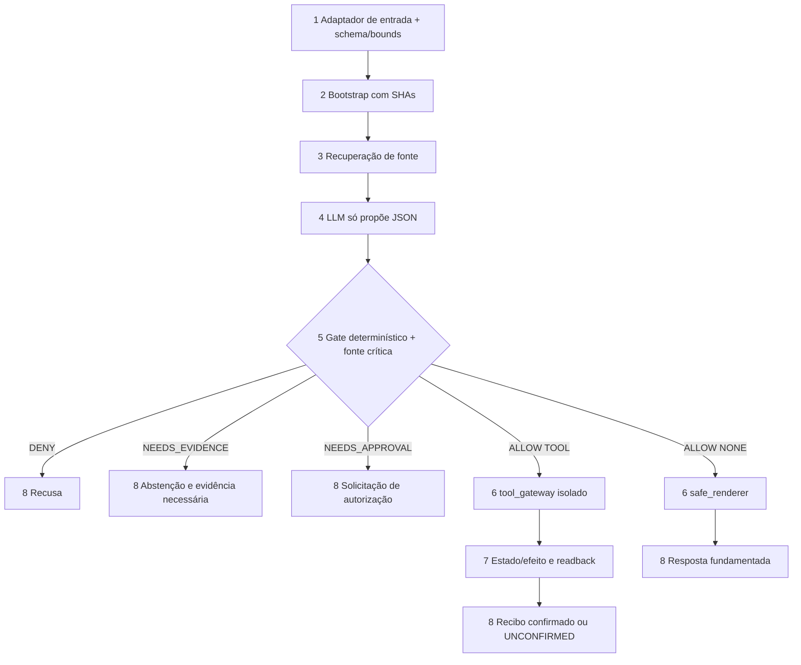
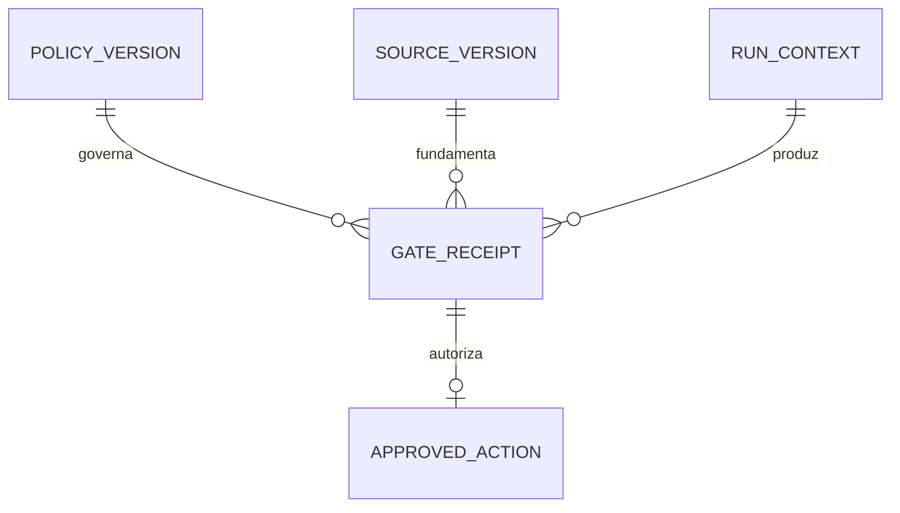
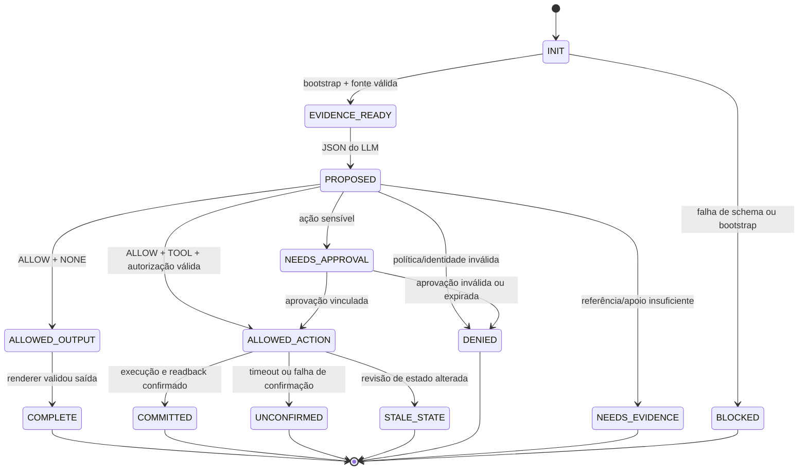

# UFMS Cognitive Gates — Harness de governança para Tutor e Coach

**Status:** PLAN v0.3-r1 **PROPOSTA CORRETIVA — AGUARDA APROVAÇÃO HUMANA**; não substitui o PLAN v0.2 aprovado, não autoriza BUILD, deploy, merge, credenciais ou dados pessoais.

**Nota de status:** qualquer coluna `Confirmed? y` preservada em Assumptions se refere a decisões históricas v0.2, não a aprovação das mudanças nesta v0.3.

**Aprovação histórica (somente PLAN v0.2)**: 2026-11-04 — usuário: "APROVO". **v0.3 NÃO APROVADO; CHECKS v0.3 apenas preview.**
**Data:** 04/11/2026 (America/Campo_Grande) | **Repositório:** `Andraus35/UFMS-MEU-ESTUDO`.
**Parecer independente de 04/11/2026:** PR #4 / SHA `0db458a50447c2a9f8e7131f402dc3be9c0db313` — GQ-D REPROVADA (1 P0, 7 P1, 1 P2). D1–D4 eram obrigações aprovadas apenas em v0.2; as mudanças v0.3 exigem novo aceite. Implementação real e go-live ainda exigem provas e decisões operacionais.
**Baseline inspecionada:** PR técnico #1 SHA `1079d7aa2cadb97d099d1e478f9e83b36180a624`; PR pedagógico #2 SHA `6e1fa661a33565d580f99962c3510d5361decbe6`. Ambas as branches estavam draft e sem merge.

## Problem

O projeto possui regras documentadas de inicialização, consulta ao edital, privacidade, estado e continuidade, além de validadores técnicos parciais. Contudo, não há fronteira unificada que prove, para **toda decisão do tutor ou coach**, que (a) foram recuperadas as evidências aplicáveis, (b) os fatos críticos foram fundamentados, (c) dados não confiáveis não alteraram regras e (d) nenhuma ferramenta foi acionada fora de autorização verificável. Hooks locais podem ser contornados por chamada direta à API; testes parciais e uma resposta plausível do LLM não demonstram conformidade operacional.

**Limite explícito:** o harness pode garantir determinísticamente apenas invariantes implementados sob seu controle de execução. Não assegura verdade universal, ausência absoluta de prompt injection ou qualidade pedagógica infalível; conteúdo gerado que escape ao renderer/gateway não está sob essas garantias.

**Resultado esperado para o estudante:** receber orientação adaptativa de qualidade mensurável, sem que o LLM possa alterar regras, inventar fontes/resultados ou praticar operações externas proibidas; quando a evidência for insuficiente, o sistema identifica o limite e oferece um próximo passo seguro.

## Shape

Reutilizar `AGENTS.md`, `settings.json`, `rules/CORE.md`, `guardrails/CORE.md`, `scripts/bootstrap.py`, `scripts/core.py`, o índice documental e as 102 condições pedagógicas, sem inventar outra base de evidências. **Regras que alteram autorização, persistência e validade de saída devem ser executadas em camada testável fora do texto produzido pelo LLM**, nunca somente no prompt.

**Path proposto:**

1. Entrada de usuário/Telegram/agendamento (entrada futura; **neste recorte inicial, entrada local sintética**) -> adaptador `(new)` confere tamanho/schema, marca conteúdo externo como dado, classifica origem, ação e risco; erro antes de invocar LLM.
2. Adaptador -> `scripts/bootstrap.py` `(exists)` e contrato de nove arquivos `(exists)`; produz `context_ref` com SHAs, não prova compreensão semântica.
3. Recuperador de fontes `(exists: edital/INDEX.md e chunks)` seleciona versão oficial, assunto 523/324 e evidência; fonte original é utilizável, retificações versionadas quando verificadas.
4. Modelo Tutor ou Coach `(new: integration boundary)` gera **proposta estruturada**, não recebe credenciais de ferramentas, não tem canal de publicação direta e não escreve estado; essa proibição deve ser demonstrada na arquitetura do executor.
5. `cognitive_policy_gate` `(new)` valida schema, evidência de origem e fatos críticos estruturados, limites, permissões e estado; retorna `ALLOW`, `NEEDS_EVIDENCE`, `NEEDS_APPROVAL` ou `DENY`, com códigos finitos e distinção `effect_kind=NONE|TOOL`. Citação existente prova localidade, não apoio semântico por si só.
6. `safe_renderer` `(new)` é a única via de saída para o usuário e só renderiza conteúdo com decisão válida para `effect_kind=NONE`; `tool_gateway` `(new)` é a única via para efeitos externos (`effect_kind=TOOL`), retém credenciais fora do LLM e exige autorização vinculada, válida, de uso único e compatível com a revisão atual. Provas locais com mocks **não** demonstram isolamento real de credenciais em provedores externos.
7. Escrita autorizada, se aplicável, passa por `scripts/core.py` `(exists)` e armazenamento de eventos `(exists; dados pessoais ainda bloqueados)`; recibo mínimo e estado/projeção com readback `(new: receipt)`.
8. Saída aprovada ao usuário e checkpoint versionado; em falha parcial, usar `UNCONFIRMED`, sem declarar `COMMITTED`, e fornecer recuperação segura. O registro não inclui prompts brutos por padrão.

**Changes underneath**

| Front | What changes |
| --- | --- |
| domain | Uma recomendação do LLM é *proposta*, não permissão de ação; `ALLOW` é decisão do gate externo |
| stored data | Preservar `state/events` legados e `settings.json.storage.personal_results_writes_enabled=false`; **sem migração neste primeiro recorte** |
| readers | Tutor e Coach passam pelo mesmo `safe_renderer`; executor externo passa apenas pelo gateway sem credenciais no LLM; canais externos ficam desligados até contrato próprio |
| fonte | A cópia local UFMS 152/2026 pode embasar estudo; retificação não verificada não pode substituir essa fonte nem ser ignorada silenciosamente |

New: entidades **propostas**, ainda sem migração: `POLICY_VERSION`, `RUN_CONTEXT`, `GATE_RECEIPT`, `APPROVED_ACTION`, com links para `SOURCE_VERSION`. Forma persistente/TTL é decisão de one-way door pendente de aprovação.

## Surface

**Conformidade metodológica:** os códigos de três dígitos abaixo são **classificações documentais de observabilidade para a Spec Lean**, NÃO um protocolo HTTP implementado, e NÃO substituem os nomes de estados nem os exit codes 0–3 do runner. Não criam endpoints nem autorizam BUILD. Cada linha deve ser verificada posteriormente no seu ambiente próprio.

| Route/Interface | In | Out | Status | Who |
| --- | --- | --- | --- | --- |
| `evaluate(proposal,context)` `(new local)` | JSON versionado com `effect_kind=NONE/TOOL`, contexto e fonte | `{decision,reason_codes,evidence_refs,effect_kind,policy_sha}` | `200 ALLOW`, `422 NEEDS_EVIDENCE`, `202 NEEDS_APPROVAL`, `403 DENY` | Apenas orquestrador; identidade inválida => `DENY:CALLER_NOT_AUTHORIZED` |
| `render(allowed_output)` `(new local)` | Proposta `NONE` + autorização de render vinculada ao run | Resposta filtrada ou `{error:{code,retryable}}` | `200 COMPLETE`, `403 DENIED`, `422 NEEDS_EVIDENCE` | Somente renderer; LLM sem canal de publicação direta |
| `execute(approved_action)` `(new local)` | Ação TOOL, política, revisão, hash e token de uso único | Recibo + readback ou `{error:{code,retryable}}` | `200 COMMITTED`, `403 DENIED`, `409 STALE_STATE`, `202 UNCONFIRMED`, `503 DEPENDENCY_FAILED` | Somente gateway com credenciais; demais => `DENY:CALLER_NOT_AUTHORIZED` |
| `evaluate-fixture <case-id>` `(new CLI)` | Fixture sintética e SHA | JSON com resultado e `case_id` | `200 / exit 0 PASS`, `409 / exit 1 divergência`, `422 / exit 2 fixture inválida`, `503 / exit 3 dependência indisponível` | Runner local/CI, sem efeitos externos |

## Contratos de confiança e avaliação — proposta v0.3 (não aprovada)

**TC-01 Trust root / fontes (AC04, AC11, AC25).** O executor resolve `policy_sha` a partir de configuração implantada e autenticada fora do texto do usuário, dos chunks, de respostas de ferramenta e de mensagens de agentes. O registro de fontes é append-only e possui `source_id, issuer, original_url_or_local_origin, document_kind, issued_at, retrieved_at, sha256_bytes, version, effective_from, supersedes_refs, affected_sections, validation_actor, validation_receipt, status`. A versão original do edital permanece preservada; retificação só tem precedência nos trechos modificados após verificação de autoria, integridade e vigência. Quando duas fontes oficiais vigentes ou o mesmo documento contêm datas/normas incompatíveis, a afirmação afetada recebe `SOURCE_CONFLICT` e vai a esclarecimento humano/fonte oficial; o LLM não decide qual seria o texto corrigido. Não bloquear o estudo de matérias não afetadas pelo conflito. O fato normativo verificável terá `fact_id, proposition, comparator, value, unit, cargo_scope, section, source_id, source_sha, page, span, validity_interval, independently_checked_by, checked_at, conflict_state`, com revisão independente humana para prazo/nota/requisito/eliminação. `source_sha/page/span` sozinho é condição necessária mas insuficiente. Campos desconhecidos continuam `UNKNOWN`.

**TC-02 Autorização humana (AC13, AC14, AC22, AC23).** Apenas o gateway recebe credenciais de ferramentas e a lista confiável de emissores/aprovadores. Aprovação é concedida fora de textos do LLM, Telegram ou PDF, com autenticação do aprovador verificável e identificação do emissor confiável. Um token assinado/autenticado contém `schema_version, issuer_id, approver_id, approval_id, actor, tool, operation, destination, recipient, action_hash, policy_sha, state_revision, source_set_sha, issued_at, expires_at, nonce, risk_class, signature_or_mac`. `action_hash = SHA256(UTF8(JCS({tool, operation, destination, recipient, parameters, attachment_digests, risk_class})))`, onde JCS significa canonicalização JSON determinística RFC 8785; parâmetros efetivos, anexos e destinatários fazem parte da operação canônica e não podem ser alterados após aprovação. Rejeitar campos obrigatórios ausentes, assinaturas inválidas, aprovação revogada, comparações divergentes, versão de política/estado/fonte obsoleta, data expirada e nonce repetido. A reserva e o consumo de nonce são atômicos e valem no máximo para **um efeito externo**, inclusive entre processos concorrentes. Uma aprovação de `calendar.create` jamais autoriza `telegram.send`, nem alteração de destinatário ou corpo. Sem autenticação confiável, `NEEDS_APPROVAL` e **zero** efeitos; correspondência falsa, `DENY:AUTH_MISMATCH` e **zero** efeitos. A contratação/guarda dos segredos do emissor e o armazenamento atômico de nonce são pendências de go-live, nunca supor que um prompt implementa isso.

**TC-03 Ferramentas e rate limit (AC15, AC22).** O gateway, antes da execução externa, compara a chamada real com allowlist versionada por `policy_sha`: ator, ferramenta, operação, domínio/destinatário, classe de risco, máximo por janela e unidades de consumo. Reserva de quota deve ser atômica contra concorrência e conter limiar e janela explícitos. Rejeição por scope ou rate limit produz **zero chamadas reais**; testes precisam instrumentar o transport/adaptador efetivo, inclusive casos nos limites, janela virada, chamadas simultâneas e resposta de ferramenta após rejeição. Mocks só demonstram lógica local; para go-live requer auditoria de credenciais, rede e canais alternativos.

**TC-04 Falhas e resultados (AC18, AC20).** A falha de dependência **antes de qualquer side effect** retorna `DEPENDENCY_FAILED`, com observação de zero chamadas. Falha que pode ter sucedido no destino mas perdeu confirmação retorna `UNCONFIRMED`, guarda chave de idempotência e proíbe replay até readback/reconciliação. Confirmação inequívoca retorna `COMMITTED`; revisão antiga retorna `STALE_STATE`; rejeição `DENIED`. No runner de fixtures, códigos `0` = evidências esperadas PASS, `1` = asserção divergente, `2` = fixture/schema inválidos, `3` = dependência indisponível; jamais usar saída vazia ou ausência de runner como PASS. Toda reivindicação funcional exige manifesto congelado com `candidate_commit_sha, tree_sha, dependency_sha_list, composition_digest, file_hashes, env, command, exit_code, assertions, evidence_path, evidence_sha256, verifier_identity` e vinculação dos testes positivos **e** negativos. Um relatório do commit A não aprova commit B com dependências modificadas.

**TC-05 Publicação (AC26).** Somente `safe_renderer` autenticado publica. Token de liberação de saída de **uso único** vincula `run_id, proposal_hash, policy_sha, state_revision, source_set_sha, actor_role, channel, recipient, output_kind, expires_at, nonce`. Mudar revisão, conjunto de fontes, canal ou destinatário, ou tentar publicar por outra rota, invalida o token e bloqueia publicação; mesmo uma resposta textual sem ferramenta externa precisa da aprovação de saída. Mocks não demonstram isolamento real dos canais; go-live só após teste de todas as rotas e ausência de credenciais de publicação no processo LLM.

**TC-06 Avaliação sem falsa garantia (AC20, AC21, AC27).** O verificador estrutural captura omissões sintáticas, não equivalência semântica. O GQ-D requer revisão humana/adversarial do significado das obrigações, comparação com oráculos positivos/negativos e mutantes capazes de inverter o requisito; falsos PASS estruturais são explicitamente insuficientes. VERIFY-C deverá registrar modelo, versão, dataset, grader, política, temperatura/configuração, trials e confiança empírica; nenhum número finito de trials garante comportamento universal. VERIFY-O requer enforcement real antes de alegar segurança de ferramentas.

## Landing

| One-way door candidata | Literal shape proposta | Alternative rejected e motivo |
| --- | --- | --- |
| D1 — recibo de gate | `schema_version, run_id, policy_sha, source_refs, actor_role, action_kind, effect_kind, decision, reason_codes, state_revision`, com identidade de execução e sem texto privado bruto por padrão | logs livres sem versão — não provam decisão nem revisão vigente |
| D2 — autorização de efeito | `{issuer_id,approver_id,approval_id,nonce,actor,tool,operation,destination,recipient,action_hash,policy_sha,state_revision,source_set_sha,expires_at,signature_or_mac}`; validar token por TC-02, ação JSON canônica, autorização autenticada, consumo atômico único e credenciais exclusivas do gateway; **default DENY** | modelo com acesso direto a ferramenta, autorização reusável ou aprovação em texto não confiável — bypass/replay |
| D3 — classificação de risco | `INFORMATIONAL`, `PEDAGOGICAL`, `SENSITIVE_EXTERNAL`, `PERSONAL_WRITE`; `effect_kind=NONE|TOOL`; escrita pessoal continua **DENY** | flag global de “tudo permitido” — mistura conselho com side effects |
| D4 — fronteira da publicação | `run_id, proposal_hash, policy_sha, state_revision, source_set_sha, actor_role, channel, recipient, decision, effect_kind` vinculados ao `safe_renderer` por TC-05; nenhuma rota de texto gerado ao usuário fora dessa fronteira **na aplicação integrada** | publicar saída do modelo diretamente — bypass da validação de fatos/regras |

**Registro histórico:** o usuário aprovou D1–D4 somente na versão v0.2. O detalhamento de D2/D4 e TC-01–TC-06 nesta v0.3 é **proposta sujeita a nova aprovação**. **Pendente para go-live:** localização/isolamento de credenciais, armazenamento atômico de nonce/TTL e recibos, retenção e arquitetura de execução efetiva. A aprovação permite provas locais sintéticas, **não** alegar isolamento de produção.

## Criteria

### S1: START confiável e contexto (P0)
**Acceptance Criteria**
1. WHEN uma sessão inicia THEN o harness SHALL conferir a existência, ordem e SHA dos **9 arquivos obrigatórios** do mesmo objeto de revisão; em qualquer falha SHALL retornar `DENY:BOOTSTRAP_INVALID`.
2. IF a proposta citar documento normativo não localizado na fonte vigente ou original identificada THEN o gate SHALL retornar `NEEDS_EVIDENCE:SOURCE_NOT_FOUND`, sem inventar número, página ou trecho.
3. WHEN uma proposta contém afirmação normativa do edital THEN o gate SHALL exigir `source_sha + page + span` resolvível na versão permitida, ou retornar `NEEDS_EVIDENCE:SOURCE_NOT_FOUND`; a presença de referência **não** prova apoio semântico.
   - Fonte válida, mas página de outro assunto → o local existe; a verificação de conteúdo pertence ao AC25.
4. IF uma suposta retificação não demonstrar autoridade emissora, URL/origem, data, SHA-256 dos bytes, vigência, trechos atingidos e recibo de validação independente THEN o gate SHALL preservar o edital original e retornar `UNVERIFIED_AMENDMENT`; IF houver incompatibilidade textual entre atos oficiais aplicáveis ou dentro de um ato THEN SHALL marcar `SOURCE_CONFLICT` para os fatos atingidos, sem escolher data alternativa por inferência.
    - Oráculo negativo: cronograma do Anexo II p.13 com datas incompatíveis não pode ser corrigido silenciosamente.

5. WHEN a fonte não cobre a pergunta THEN o tutor SHALL devolver estado `UNKNOWN` e próximo passo seguro; não SHALL criar dado de questão ou percentual fictício.

### S2: Decisão pedagógica e qualidade (P1)
**Acceptance Criteria**
6. WHEN o LLM propõe um caderno THEN a saída SHALL conter cargo (523/324), tópico existente, objetivo pedagógico, status de disponibilidade `CONFIRMED/UNKNOWN` e justificativa, sem fabricar URL ou questão.
7. IF o relatório de resultados não distinguir contagens ou temas THEN o gate SHALL preservar os totais observados e deixar os campos não demonstrados como `unknown`, sem imputar desempenho por subtópico.
8. WHEN o tutor ou coach recebe um relato de aprendizagem THEN SHALL distinguir `observado`, `informado`, `inferido` e `desconhecido` nos fatos usados para decisão.
9. IF duas recomendações compartilham um bloco parcial 523/324 THEN o sistema SHALL impedir dupla contagem de uma mesma tentativa sob dois IDs de evidência.
10. WHEN a recomendação envolver revisão THEN o sistema SHALL registrar a justificativa baseada no histórico disponível ou declarar `insufficient_evidence`; não SHALL assumir intervalo fixo de repetição por padrão.

### S3: Contenção, autorização e segurança (P0)
**Acceptance Criteria**
11. WHEN conteúdo de PDF, questão, CSV, Telegram ou ferramenta for incorporado ao contexto THEN o executor SHALL carregar `policy_sha` exclusivamente de trust root autenticada, nunca de payload externo, e SHALL rejeitar qualquer instrução desses dados que tente modificar autorização, política ou precedência de fontes; verificar por diff da política vigente e contador de chamadas reais igual a zero.
    - Oráculo: documento malicioso contendo texto semelhante a política assinada não altera política ou token.

12. WHILE `personal_results_writes_enabled=false`, WHEN qualquer agente solicitar persistência de resultado real THEN o gateway SHALL retornar `DENY:PERSONAL_WRITE_DISABLED`, sem chamada de escrita.
13. IF ação exigir autorização humana e NÃO existir token de aprovação autenticado por emissor/aprovador confiáveis para **operação, ferramenta, destino, destinatário, parâmetros, ator, risco, policy_sha, state_revision e source_set_sha efetivos**, com validade temporal e nonce disponível THEN o gateway SHALL retornar `NEEDS_APPROVAL` (token ausente) ou `DENY:AUTH_MISMATCH` (token incompatível), sem efeito externo.
    - Mensagem Telegram dizendo “autorizo” não substitui token emitido pelo autorizador confiável.

14. IF token aprovado divergir em **issuer_id, approver_id, actor, tool, operation, destination, recipient, canonical action_hash, risk_class, policy_sha, state_revision, source_set_sha**, assinatura/MAC, validade ou status de aprovação da operação executada THEN o gateway SHALL retornar `DENY:AUTH_MISMATCH`, com **zero invocações externas**; rejeitar serialização não canônica ou parâmetros não aprovados.
    - Token para `calendar.create` apresentado a `telegram.send`, ou para destinatário diferente, deve falhar.

15. WHEN chamada a ferramenta violar allowlist/escopo **versionados por policy_sha** ou exceder o limite **por ator, operação, janela e concorrência** THEN gateway SHALL retornar `DENY:TOOL_NOT_AUTHORIZED` ou `DENY:RATE_LIMITED` **antes do transport externo**, comprovando zero efeitos, e testes SHALL cobrir limiar exato, um acima, janela, corrida e renovação.

### S4: Integridade, falhas e prova (P0/P1)
**Acceptance Criteria**
16. WHEN uma solicitação com o mesmo `event_id` for recebida novamente THEN o validador SHALL impedir segundo registro/efeito e retornar o resultado idempotente ou conflito explícito sem duplicação.
17. IF duas decisões usam a mesma revisão de estado e a primeira grava uma alteração THEN a segunda SHALL retornar `STALE_STATE` e **não** efetuar escrita antes de reavaliar o estado atual.
18. IF dependência falhar **antes** de qualquer execução externa THEN gateway SHALL devolver `DEPENDENCY_FAILED` comprovando zero efeitos; IF execução puder ter ocorrido mas readback falhar THEN SHALL devolver `UNCONFIRMED` (nunca `COMMITTED`), guardar chave de idempotência e bloquear retry sem reconciliação; o runner SHALL distinguir saídas 0, 1, 2 e 3 nos seus próprios testes.

19. WHEN um ciclo terminar THEN o sistema SHALL emitir um recibo mínimo com `policy_sha`, `run_id`, `decision`, `reason_codes` e `source_refs`, sem gravar conteúdo bruto privado por padrão.
20. WHEN se reivindicar aprovação de gate ou execução em candidato composto THEN SHALL existir recibo de prova com `candidate_commit_sha`, árvore, SHAs exatos de dependências, `composition_digest`, comandos, saídas e hashes dos artefatos positivos/negativos; ausência, drift ou composição implícita SHALL produzir `BLOCKED:NO_PROOF`. O checkout sintético de verificação não SHALL modificar qualquer PR nem substituir base por HEAD móvel.

21. IF a revisão independente encontrar teste que também passa com o comportamento propositalmente falso THEN a homologação SHALL retornar `BLOCKED:WEAK_PROOF`, exigindo revisão do teste e nova execução no SHA exato.
    - Mutante remove validação de autorização e o teste segue verde → release bloqueado.

### S5: Fronteiras difíceis de contornar e validade de avaliação (P0)

**Acceptance Criteria**
22. WHEN LLM, Tutor, Coach ou canal tentar chamar ferramenta fora do gateway/renderer autenticados THEN executor SHALL rejeitar com `DENY:CALLER_NOT_AUTHORIZED`, instrumentar **zero chamadas/efeitos reais** e impedir acesso direto a segredos, tokens e rede privilegiada. A inspeção do isolamento real de credenciais e canais é bloqueador de go-live não demonstrável só por mock.

23. IF um token de autorização já tiver sido consumido, expirado ou apresentar `nonce` duplicado THEN o gateway SHALL retornar `DENY:AUTH_REPLAY`, sem novo efeito.
    - Repetir exatamente o token após uma execução confirmada → 0 novas chamadas; timeout → reconciliar resultado antes de qualquer retry.
24. IF JSON de proposta ultrapassar **65.536 bytes** ou um payload externo ultrapassar **262.144 bytes** THEN o adaptador SHALL retornar `DENY:INPUT_TOO_LARGE` antes de invocar LLM ou ferramentas.
    - Limites inclusivos em bytes UTF-8; validar exatamente no limiar e um byte acima; tornar ambos configuráveis com baseline versionada.
25. WHEN afirmação crítica sobre prazo, nota, requisito ou eliminação diferir de registro de fatos **independentemente verificado** e vigente, ou envolver fontes oficiais conflitantes THEN gate SHALL devolver `NEEDS_EVIDENCE:CLAIM_UNSUPPORTED` ou `NEEDS_EVIDENCE:SOURCE_CONFLICT`, mantendo o estado não confirmado, mesmo que `source_sha/page/span` exista. O oráculo SHALL registrar valor, escopo, versão, vigência, trecho, conferente e conflito; jamais aceitar a citação real isolada como comprovação semântica.
    - Contraprovas: “pode zerar Inglês com 60 pontos” citando itens 10.1/10.2 é falso; incompatibilidade do cronograma na p.13 exige alerta, não adivinhação.

26. WHEN LLM produzir resposta para publicação THEN SHALL passar exclusivamente pelo `safe_renderer`; sem token íntegro, não expirado, de uso único e vinculado ao **run_id + proposal_hash + policy_sha + state_revision + source_set_sha + actor_role + channel + recipient** efetivos SHALL devolver `DENY:OUTPUT_NOT_APPROVED` com zero publicações; revisão/fonte/canal/recipient alterado ou bypass SHALL invalidar token anterior.

27. IF uma avaliação de release do LLM não informar `model_version`, `policy_sha`, `dataset_sha`, `grader_version` e número de trials por cenário THEN o gate de release SHALL retornar `BLOCKED:EVAL_METADATA_MISSING`.
    - 40 cenários com 5 trials por cenário são **desenho inicial**, não um atestado de baixa taxa de falhas; separar holdout e calibração humana.

## Observable

**Natureza:** matriz documental de resultados observáveis nas quatro interfaces propostas; cada vínculo AC indica obrigação a demonstrar no futuro, não prova executada. Os códigos de 3 dígitos são aliases documentais da seção Surface; no runner preservam-se os exit codes 0–3. Não há interface de produção instalada.

| Surface | Estado observável | Landing (critério EARS a provar) |
| --- | --- | --- |
| `evaluate` | `200 ALLOW` | AC06, AC11, AC26 — saída permitida somente quando elegível |
| `evaluate` | `422 NEEDS_EVIDENCE` | AC02, AC03, AC25 — fonte desconhecida, conflito ou citação sem suporte |
| `evaluate` | `202 NEEDS_APPROVAL` | AC13, AC14 — autorização ausente ou inválida, zero efeitos |
| `evaluate` | `403 DENY` | AC01, AC11, AC12, AC24 — entrada ou política impeditiva |
| `render` | `200 COMPLETE` | AC25, AC26 — somente conteúdo aprovado, vinculado ao estado |
| `render` | `403 DENIED` | AC26 — token inválido, expirado, reusado ou publicação fora da rota |
| `render` | `422 NEEDS_EVIDENCE` | AC02, AC25, AC26 — falta de apoio normativo ou conflito |
| `execute` | `200 COMMITTED` | AC16, AC17, AC18 — efeito confirmado por readback |
| `execute` | `403 DENIED` | AC12, AC14, AC15, AC22, AC23 — bloqueio com zero efeitos |
| `execute` | `409 STALE_STATE` | AC17 — concorrência sobre revisão antiga |
| `execute` | `202 UNCONFIRMED` | AC18 — possível efeito sem confirmação; bloquear replay |
| `execute` | `503 DEPENDENCY_FAILED` | AC18 — indisponibilidade antes do efeito |
| `evaluate-fixture` | `200 / exit 0` | AC20, AC21 — testes realmente executados e adequados |
| `evaluate-fixture` | `409 / exit 1` | AC20, AC21 — divergência real na asserção |
| `evaluate-fixture` | `422 / exit 2` | AC20 — schema/fixture inválidos |
| `evaluate-fixture` | `503 / exit 3` | AC18, AC20 — dependência indisponível não tratada como PASS |

## Flow

1. Recuperar a fonte confiável e o manifesto de composição exato; sem eles, a fase VERIFY-O é `BLOCKED`.
2. Classificar entrada como dado não confiável ou regra autenticada; LLM produz proposta sem credenciais.
3. Conferir evidência normativa e histórico, incluindo conflitos internos da própria fonte oficial.
4. Aplicar política e autorização vinculada a ação canônica; sem prova, não publicar/executar.
5. Conciliar resultados com readback; registrar recibos por SHA e estado seguro de falha.

## Impact

- **Sem BUILD obrigatório documental:** os contratos TC-01–TC-06 estabelecem o que um executor futuro deverá comprovar, não implementam uma fronteira de segurança.
- **GQ-D:** exige contrato audível, oráculos falsificáveis e reauditoria adversarial independente. **GQ-C:** exige trials de LLM. **GQ-O:** exige imposição real de ferramentas, credenciais e canais.
- **Dados:** o edital original é fonte primária utilizável; retificações só após verificação. Escrita de resultados pessoais continua proibida.

## Relations

- **Objeto predecessor reprovado (imutável):** PR #4, commit `0db458a50447c2a9f8e7131f402dc3be9c0db313`, PLAN v0.2 e CHECKS C1–C27.
- **Frente técnica fixa para leitura:** PR #1 `1079d7aa2cadb97d099d1e478f9e83b36180a624` (SHA de referência; se mudar, abrir nova composição).
- **Frente pedagógica fixa para leitura:** PR #2 `6e1fa661a33565d580f99962c3510d5361decbe6` (SHA de referência; não alterada).
- **Manifesto externo:** `composition-manifest.json`; a combinação é somente **read-only**, nunca merge simulado como prova de versão efetiva.
- **Metodologia:** Spec Lean é referência de estrutura; a adaptação PLAN→CHECKS→VERIFY sem BUILD operacional não reivindica cumprimento integral do processo oficial da skill.

## Out of scope

| Excluded | Why |
| --- | --- |
| Interface web, painel/dashboards, aplicativo próprio | Não agregam valor à prova do harness nesta fase |
| Implantação Oracle, Telegram e Google Calendar em produção | Requer tokens, credenciais, políticas e aprovação externa independentes |
| Importação automática de bases privadas TEC/Qconcursos | Não foi autorizada; manter seleção manual e fontes legítimas |
| Reescrita do `core.py` e migração IGP-12/13/14 | Escopo da sessão técnica; protótipos anteriores permanecem não integrados |
| Gravação de resultados pessoais, CPF, credenciais e histórico privado | Bloqueado por política vigente; tratar em feature e consentimento separados |
| Fine-tuning, modelos próprios e prova de correção universal do LLM | Não necessários nem tecnicamente demonstráveis por testes finitos |

## Assumptions

| Assumption | Chosen default | Rationale | Confirmed? |
| --- | --- | --- | --- |
| Arquitetura preferida | Harness-first com gateway determinístico mínimo | Menor software e melhor fronteira para efeitos externos | y — aprovado no PLAN, escopo local |
| Escopo inicial | CLI/fixtures sintéticas; Tutor/Coach como papéis lógicos | Evita credenciais, custos e dependências externas | y — escopo inicial aprovado |
| Persistência de recibos | Metadados mínimos sem PII, retenção definida antes de produção | Privacidade por padrão | y — política; retenção operacional pendente |
| Escalas de severidade | P0 para privacidade/ferramenta/versão, P1 para qualidade pedagógica | Falha de ferramenta é mais grave que estilo de resposta | y — baseline aprovado |
| Dataset inicial | 40 casos, 5 repetições por caso quando houver LLM | Ponto de partida adaptado de recomendações de evals, não limite normativo | y — ponto de partida, não meta de segurança |
| Bounds de entrada | 65.536 bytes JSON; 262.144 bytes payload externo | Padrões provisórios para evitar abuso de recursos, calibráveis no BUILD | y — baseline versionado |
| Checagem de fatos críticos | registro de fatos conferidos e abstenção diante de divergência | Citação existente não prova suporte semântico | y — obrigação aprovada |

**Open questions:**
- `settled` (04/11/2026): **gateway com exclusividade de credenciais + renderer obrigatório** aprovados como obrigações, sem autorizar acesso externo nesta fase.
- `settled` (04/11/2026): fatos normativos críticos devem ser confrontados com registros conferidos; caso não seja possível, o gate se abstém/encaminha a revisão, sem certificar por citação isolada.
- `blocks go-live`: definir executor/provedor LLM, segregação de credenciais, nonce atômico, TTL, limites de custo/uso e roteamento obrigatório da saída; decidir retenção/local do recibo e acesso aos traces.
- `open`: calibrar objetivos estatísticos de qualidade com baseline, sem confundir com checks determinísticos.

## Differences from the source

None — esta feature não recebe captura ou interface visual vinculante. Os documentos existentes do projeto são fontes de regras, não capturas visuais.

## Sources

- `AGENTS.md`, `settings.json`, `rules/CORE.md`, `guardrails/CORE.md` no SHA técnico `1079d7aa2cadb97d099d1e478f9e83b36180a624` — binding para restrições atuais de bootstrap, privacidade e fonte.
- `docs/pedagogia/README.md`, `CONTRATO_PRONTIDAO_v1.7.md` e `CRITERIOS_DE_ACEITACAO.md` no PR pedagógico #2 SHA `6e1fa661a33565d580f99962c3510d5361decbe6` — binding para estratégia e critérios já documentados.
- Tech Leads Club, Spec Lean v2.2.0 (processo de especificação, não requisito de produto): https://agent-skills.techleads.club/skills/tlc-spec-lean/
- [Pesquisa de referências e benchmark](../../../benchmark.md) — non-binding como fonte de orientação, não como prova de implementação.

**Protocolo de fase v0.3:** a aprovação "APROVO" refere-se **somente** ao v0.2, não a estes critérios alterados. Encaminhar PLAN v0.3 e contraprovas ao responsável, **obter novo aceite expresso** e só então derivar/congelar CHECKS v0.3. `git push`, deploy, uso de credenciais, escrita pessoal e merge exigem autorização separada. CHECKS só estarão mecanicamente congelados quando `validate_checks.py` da skill passar; na ausência do validador oficial, registrar validação local como degradada, não como homologação.

**Ponto de corte:** V0.3 é *candidata corretiva para revisão*; NCs tratadas no documento não são encerradas antes de reauditoria; nenhum teste aqui comprova efeito externo, controle real de credenciais ou cognição do LLM.
