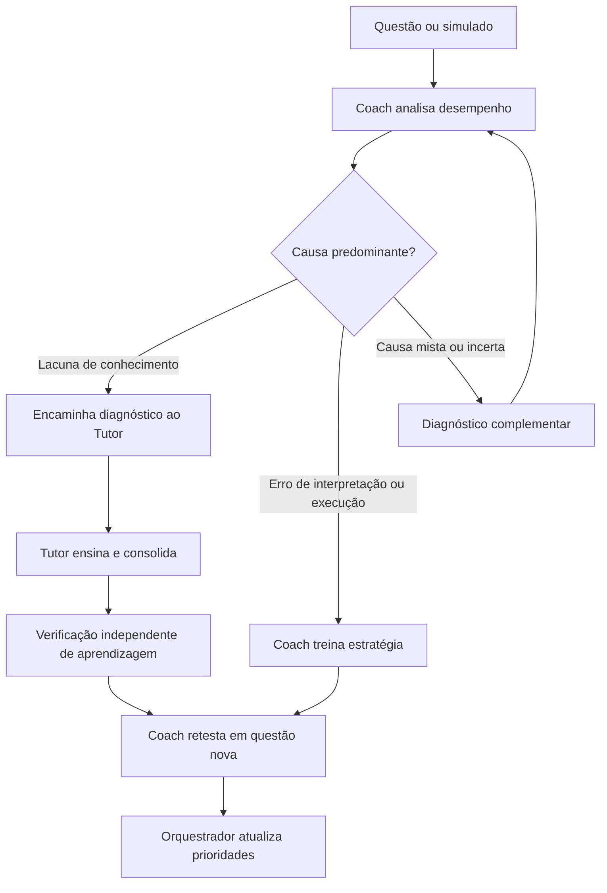

# Inteligência adversarial das bancas de concursos públicos

**Pesquisa, taxonomia analítica, recomendações e requisitos para o Coach de Prova**

- **ID:** `PESQUISA-COACH-PROVA-001`
- **Versão:** 1.0
- **Data:** 16/11/2026
- **Natureza:** documento-fonte de pesquisa e recomendação
- **Destinatário arquitetural:** Coach de Prova
- **Relação com outros componentes:** Tutor de Aprendizagem e Orquestrador

## 1. Resumo executivo

Este documento consolida a pesquisa sobre práticas de elaboração de itens de avaliação, mecanismos de indução e confusão que podem aparecer em questões de concursos, efeitos de carga cognitiva e fadiga, estratégias de defesa do candidato e recomendações para o harness cognitivo.

A conclusão arquitetural é que o estudo sistemático das bancas, a análise de distratores, o treinamento contra induções, a estratégia de resolução, a administração do tempo e a preparação para condições de prova pertencem **predominantemente ao Coach de Prova**.

O Tutor de Aprendizagem deve permanecer responsável por construir conhecimento, compreensão, retenção e recuperação. O Coach utiliza esse conhecimento em situações de avaliação e transforma evidências de desempenho em diagnósticos. O Orquestrador coordena prioridades e encaminha intervenções ao agente adequado.

A pesquisa não autoriza afirmar que bancas brasileiras adotem deliberadamente uma estratégia psicológica de exaustão ou que todas usem as mesmas técnicas. É necessário distinguir:

1. práticas documentadas de elaboração e validação de itens;
2. características observáveis de questões e provas;
3. efeitos cognitivos demonstrados em estudos;
4. hipóteses analíticas sobre a intenção do elaborador;
5. defeitos de construção, ambiguidade ou erro material.

**Princípio central:** preparar o candidato para demonstrar o conhecimento de forma precisa, autônoma e estável, mesmo diante de formulações difíceis, pressão temporal e incerteza — sem transformar conjecturas sobre a intenção da banca em fatos.

## 2. Objetivo e limites

### 2.1 Objetivo

Construir uma base de inteligência de prova para que o Coach consiga:

- compreender como itens de avaliação são estruturados;
- reconhecer formatos de enunciados e alternativas;
- identificar alterações semânticas, lógicas, normativas e contextuais;
- diagnosticar erros de interpretação e de execução;
- treinar a validação integral de proposições;
- preparar o candidato para diferentes formatos de prova e regras de pontuação;
- medir precisão, robustez, tempo, confiança e estabilidade de desempenho;
- devolver ao Tutor apenas as lacunas de conhecimento que exigem intervenção pedagógica.

### 2.2 Limites epistemológicos

Não se deve confundir:

- **efeito observado** com intenção deliberada da banca;
- **distrator plausível** com pegadinha;
- **questão difícil** com questão defeituosa;
- **erro de conhecimento** com erro de interpretação ou decisão;
- **característica de uma prova** com padrão universal de uma banca;
- **prática de avaliação educacional** com prática comprovada de concursos públicos.

A taxonomia deste documento é uma ferramenta analítica de treinamento. Seus nomes não são uma nomenclatura oficial universal das bancas.

## 3. Como itens de avaliação são construídos

A elaboração técnica de itens costuma envolver, em linhas gerais:

1. definição do domínio, matriz ou especificação de avaliação;
2. identificação do conteúdo, competência ou habilidade a avaliar;
3. elaboração do enunciado e do comando;
4. construção da resposta esperada e dos distratores;
5. revisão de conteúdo, linguagem, clareza e adequação;
6. validação e, quando aplicável, análise estatística do comportamento dos itens;
7. montagem da prova e distribuição dos itens.

O Guia de Elaboração e Revisão de Itens do Banco Nacional de Itens do Enade, publicado pelo Inep em 2023, é uma referência brasileira útil para compreender elaboração, revisão e qualidade de itens. Ele é uma referência de avaliação educacional, não um manual interno de todas as bancas de concursos.

O NBME, instituição de avaliação na área de ciências da saúde, publica um guia de elaboração de itens baseado em décadas de desenvolvimento de avaliações. Sua página pública descreve a cobertura de escrita de itens, vinhetas, psicometria e mensuração. O material é útil como referência metodológica, mas seu contexto original não é o de concursos brasileiros.

### 3.1 Distratores

Distratores são alternativas incorretas. Em uma questão bem construída, devem ser plausíveis e relacionadas a erros de raciocínio ou compreensão que o elaborador pretende detectar.

Um distrator pode explorar, por exemplo:

- confusão entre conceitos próximos;
- aplicação de uma regra fora de suas condições;
- omissão de exceção;
- erro de competência;
- inversão de consequência;
- troca de prazo;
- interpretação incompleta do comando.

Uma alternativa incorreta não deve ser considerada uma armadilha apenas por ser atraente. A análise deve verificar se ela representa um erro plausível e se o item permanece claro, válido e com resposta determinável.

### 3.2 Dificuldade, discriminação e acerto casual

Na avaliação psicométrica, são conceitos relevantes:

- **Dificuldade:** proporção ou probabilidade de acerto do item, conforme o modelo empregado.
- **Discriminação:** capacidade do item de diferenciar níveis de proficiência.
- **Acerto casual:** possibilidade de resposta correta sem domínio correspondente, por exemplo, por chute.

Um item difícil não é automaticamente um item de qualidade. Um item pode ser difícil por exigir conhecimento aprofundado ou por conter características irrelevantes, ambiguidade ou defeitos de redação.

A documentação institucional do Cebraspe descreve o uso de conceitos da Teoria Clássica dos Testes e da Teoria de Resposta ao Item em avaliações educacionais. Isso não permite concluir que todo concurso organizado pela instituição use TRI para calcular sua nota. A regra de pontuação de cada certame deve ser extraída do edital específico.

## 4. Taxonomia analítica de induções, confusões e distorções

As categorias abaixo foram organizadas para análise de questões e treinamento. Não se afirma que sejam nomes oficiais usados pelas bancas.

### 4.1 Indução semântica e alteração de alcance

| Técnica | Funcionamento | Erro provável |
|---|---|---|
| Absolutização | Introduz “sempre”, “nunca”, “necessariamente” ou “em qualquer hipótese” | Aceitar ou rejeitar sem conferir a abrangência |
| Generalização indevida | Estende regra limitada a todos os casos | Aplicar exceção como regra universal |
| Restrição indevida | Acrescenta “somente”, “apenas” ou “exclusivamente” | Reduzir indevidamente o campo de aplicação |
| Quantificador alterado | Troca “alguns” por “todos”, “pode” por “deve” | Ignorar mudança de modalidade ou quantidade |
| Negação invertida | Usa “não”, “incorreto”, “exceto” ou dupla negação | Julgar no sentido contrário ao comando |
| Condição omitida | Retira requisito, pressuposto ou ressalva | Aplicar regra fora de suas condições |
| Equivalência falsa | Trata conceitos relacionados como sinônimos | Confundir institutos distintos |

**Defesa:** decompor a proposição em sujeito, ação, objeto, condição, abrangência, modalidade e consequência.

### 4.2 Extrapolação

| Tipo | Funcionamento |
|---|---|
| Normativa | Transfere uma regra para hipótese não abrangida |
| Temporal | Aplica regra fora de seu período de vigência ou ignora alteração normativa |
| De competência | Atribui a órgão ou agente competência que não possui |
| De exceção | Converte exceção em regra geral |
| De finalidade | Confunde finalidade normativa com autorização |
| Causal | Trata associação como causalidade |
| Quantitativa | Generaliza a partir de dados limitados |
| Contextual | Transporta uma regra para contexto diferente |

**Pergunta defensiva:** qual é exatamente o universo de aplicação da regra e quais condições limitam sua incidência?

### 4.3 Invenção ou fabricação de relações

| Técnica | Funcionamento |
|---|---|
| Instituto inexistente | Apresenta denominação com aparência técnica, mas sem fundamento |
| Competência inventada | Atribui poder a autoridade ou órgão sem base |
| Procedimento híbrido | Combina etapas de procedimentos diferentes |
| Prazo deslocado | Usa prazo verdadeiro de outro instituto |
| Classificação fabricada | Cria subdivisão ou categoria não sustentada |
| Referência normativa falsa | Associa dispositivo a consequência que ele não estabelece |
| Requisito transplantado | Insere condição pertencente a outro instituto |
| Consequência inventada | Apresenta resultado que não decorre da disciplina aplicável |

O risco principal é o reconhecimento superficial: o candidato identifica termos familiares e aceita uma relação que não foi validada.

**Defesa:** validar não apenas os componentes da frase, mas também a relação entre eles e sua fonte.

### 4.4 Tangenciamento e deslocamento do objeto

| Tipo | Funcionamento |
|---|---|
| Temático | A narrativa apresenta um tema, mas o comando exige outro conteúdo |
| Conceitual | Exige distinguir conceitos próximos |
| Interpretativo | O candidato precisa identificar a pergunta efetivamente formulada |
| Normativo | A resolução depende da interação entre normas |
| Operacional | A questão exige escolher uma providência, não apenas definir um instituto |

O tangenciamento não é necessariamente defeito. Pode ser legítimo quando a matriz prevê integração e aplicação de conhecimentos. O problema surge quando a exigência fica fora do escopo anunciado ou o comando não permite identificar o que está sendo avaliado.

### 4.5 Distratores de quase-verdade (*near miss*)

A alternativa contém grande parte de uma proposição correta, mas altera um elemento decisivo:

- sujeito ou autoridade;
- ação;
- condição;
- prazo ou marco temporal;
- modalidade (pode/deve; permitido/obrigatório);
- fundamento;
- consequência.

**Regra defensiva:** nunca aprovar uma alternativa por reconhecimento parcial. A proposição inteira precisa ser validada.

### 4.6 Contextualização e ancoragem

A narrativa pode induzir o candidato a ativar um conceito familiar antes de identificar o comando.

Possíveis efeitos:

- ancoragem temática;
- ancoragem lexical;
- ancoragem contextual;
- deslocamento de foco entre narrativa e pergunta final.

**Defesa:** ler o comando, identificar o objeto de resposta e só então processar os fatos relevantes do enunciado.

### 4.7 Encadeamento de proposições

Questões podem combinar várias operações: identificar hipótese, reconhecer competência, aplicar exceção e determinar consequência.

Em itens de asserção e razão, cada proposição deve ser julgada separadamente antes de avaliar a relação entre elas.

**Defesa:** decompor a questão em afirmações independentes e validar cada uma antes de avaliar combinações.

## 5. Engenharia de alternativas e pistas de resolução

Guias de elaboração de itens apontam defeitos que podem permitir acertos sem domínio real do conteúdo. Entre as pistas de construção que uma boa revisão procura evitar estão:

- diferença injustificada de comprimento entre alternativas;
- repetição de palavras do enunciado apenas na resposta correta;
- pistas gramaticais;
- alternativas heterogêneas;
- termos absolutos usados de forma previsível;
- alternativa correta muito mais detalhada que as demais;
- opções que se excluem por lógica ou forma, sem exigir o conhecimento avaliado.

Essas características não devem ser usadas como regras automáticas de gabarito. “Alternativa extensa é correta” e “sempre/nunca significa erro” são heurísticas frágeis.

### 5.1 Técnica de antecipação da resposta

Em questões de múltipla escolha, o Coach pode treinar o candidato a:

1. ler o comando e o enunciado;
2. formular uma resposta provisória sem consultar as opções;
3. comparar a resposta antecipada com as alternativas;
4. validar cada alternativa contra a regra ou evidência;
5. rejeitar opções que sejam verdadeiras em geral, mas não respondam ao comando específico.

Essa estratégia reduz a influência das alternativas sobre a interpretação inicial.

## 6. Carga cognitiva, pressão temporal e fadiga

É necessário distinguir:

- **Carga cognitiva:** recursos mentais exigidos para processar a tarefa.
- **Pressão temporal:** necessidade de concluir dentro do tempo disponível.
- **Fadiga:** alteração de eficiência ou esforço ao longo de uma atividade prolongada.
- **Ansiedade e motivação:** fatores que podem interagir com desempenho, mas não são equivalentes a fadiga.

Uma prova pode se tornar exigente pela combinação de:

1. leitura extensa;
2. memória de trabalho ocupada por múltiplas condições;
3. alternância entre disciplinas;
4. comparação de alternativas semelhantes;
5. decisões repetidas sob incerteza;
6. pressão de tempo;
7. esforço acumulado ao longo do caderno.

Não se deve concluir que uma banca planejou deliberadamente exaurir o candidato apenas porque a prova é longa ou difícil.

### 6.1 Evidência empírica brasileira sobre efeito de posição

Barichello, Guimarães e Figueiredo Filho publicaram em 2022 o estudo “A formatação da prova afeta o desempenho dos estudantes? Evidências do Enem (2016)”.

O estudo analisou 4.427.790 registros da área de Matemática e suas Tecnologias do Enem 2016. Os autores encontraram evidências de redução na proporção de acertos conforme o item aparecia mais próximo do final do caderno; o resumo reporta redução de até 18 pontos percentuais em comparações específicas, controlado o nível de desempenho.

**Limitação essencial:** o estudo trata de uma edição do Enem, uma área e uma configuração de prova. Não prova que concursos específicos reproduzam o mesmo efeito nem que a ordem tenha sido escolhida para induzir fadiga intencionalmente.

### 6.2 Implicações de treinamento

O Coach deve observar se a precisão do candidato se altera ao longo de sessões longas, mas não deve diagnosticar fadiga com base em uma única sessão.

A avaliação deve controlar, quando possível:

- dificuldade e tipo de item;
- disciplina;
- posição na sessão;
- tempo gasto;
- taxa de omissão;
- confiança declarada;
- interrupções e condições de aplicação;
- familiaridade com o conteúdo.

Treinos de resistência devem ser graduais, realistas e voltados à estabilidade de desempenho, sem estimular privação de sono ou esforço prejudicial.

## 7. Formatos de prova e decisão

O Coach deve tratar formato e regra de pontuação como parâmetros específicos do edital.

### 7.1 Certo/errado com penalização

Quando o edital estabelece pontuação positiva para acerto, negativa para erro e zero para branco, o candidato precisa considerar o risco de resposta.

Para um modelo simplificado de +1 por acerto, -1 por erro e 0 por branco:

\[
E(p)=p-(1-p)=2p-1
\]

O valor esperado é positivo se a probabilidade estimada de acerto superar 50%. Essa conta é apenas ilustrativa: o candidato deve considerar pesos, regras de anulação, blocos, notas mínimas e demais condições do edital real.

### 7.2 Múltipla escolha

O Coach deve treinar:

- leitura precisa do comando;
- antecipação da resposta;
- comparação de alternativas;
- detecção de quase-verdades;
- validação integral;
- eliminação fundamentada, não por pistas frágeis.

### 7.3 Regras de edital

Não presumir formato, número de alternativas, penalização, pesos, tempo ou critério de classificação com base apenas no nome da banca. Registrar a fonte oficial e a versão do edital aplicável.

## 8. Protocolo operacional de desmontagem de questão

O Coach deve ensinar e avaliar uma sequência de análise:

1. **Comando:** o que a questão solicita?
2. **Polaridade:** pede correto, incorreto, exceto ou melhor resposta?
3. **Sujeito:** quem pratica a ação?
4. **Ação:** o que está sendo atribuído ao sujeito?
5. **Objeto:** sobre o que recai a ação?
6. **Condições:** quais pressupostos e ressalvas se aplicam?
7. **Abrangência:** há generalização ou restrição indevida?
8. **Temporalidade:** qual vigência, prazo ou marco temporal?
9. **Fundamento:** qual norma, conceito ou evidência sustenta a afirmação?
10. **Consequência:** o resultado decorre efetivamente da regra?
11. **Relações:** os conceitos foram combinados corretamente?
12. **Julgamento:** a proposição inteira é válida?

### 8.1 Método da menor unidade falsa

Quando uma alternativa parecer correta, o candidato deve localizar o menor elemento que poderia invalidá-la. Deve examinar sujeito, verbo, objeto, condição, modalidade, abrangência, prazo, fundamento e consequência.

O objetivo não é procurar defeito imaginário em toda frase, mas verificar com precisão o elemento que determina sua validade.

## 9. Matriz de classificação de erros

O Coach deve registrar a causa provável do erro, evitando classificar todo erro como “falta de conhecimento”.

| Código | Família | Diagnóstico |
|---|---|---|
| `KNW` | Conhecimento | Regra ou conceito não conhecido |
| `SEM` | Semântica | Alteração de significado |
| `QNT` | Quantificador | Todos, alguns, sempre, nunca, apenas |
| `NEG` | Negação | Polaridade ou comando invertido |
| `EXT` | Extrapolação | Regra aplicada além de seu alcance |
| `INS` | Institutos | Confusão entre conceitos próximos |
| `INV` | Invenção | Relação ou informação sem fundamento |
| `TMP` | Temporalidade | Prazo, vigência ou marco incorreto |
| `CMP` | Competência | Sujeito ou autoridade incorretos |
| `CON` | Condição | Pressuposto ou exceção omitidos |
| `CONC` | Consequência | Resultado incorreto |
| `TAN` | Tangenciamento | Objeto efetivamente cobrado não identificado |
| `REL` | Relação lógica | Proposições individualmente verdadeiras, relação falsa |
| `CAR` | Carga cognitiva | Sobrecarga de leitura ou processamento |
| `DEC` | Decisão | Gestão inadequada de incerteza ou risco |
| `TEM` | Tempo | Gestão temporal inadequada |
| `FAD` | Estabilidade | Queda de desempenho ao longo da sessão, a investigar |

A classificação deve admitir múltiplos códigos quando houver causas combinadas. A causa não deve ser inferida apenas pelo gabarito: usar justificativa do candidato, confiança, tempo, padrão de respostas e, quando necessário, pergunta diagnóstica.

## 10. Separação arquitetural: Tutor, Coach e Orquestrador

### 10.1 Tutor de Aprendizagem — construir competência

Responsabilidade primária:

- ensinar conceitos e fundamentos;
- estruturar conhecimento;
- promover recuperação ativa;
- programar prática espaçada;
- fornecer feedback corretivo;
- identificar lacunas de compreensão;
- verificar retenção e transferência;
- desenvolver recuperação independente de assistência.

O Tutor não deve assumir como missão principal a inteligência das bancas, estratégia de prova ou treinamento de decisão sob tempo.

### 10.2 Coach de Prova — converter competência em desempenho

Responsabilidade primária:

- estudar editais e provas anteriores;
- caracterizar formatos e padrões observáveis;
- classificar questões e distratores;
- treinar interpretação do comando;
- treinar resistência a extrapolações e induções;
- treinar comparação de alternativas;
- desenvolver estratégia de resolução;
- treinar gestão de tempo e risco;
- simular condições realistas de prova;
- diagnosticar erros de execução;
- avaliar estabilidade de desempenho.

O Coach não deve substituir o ensino de conteúdo quando a causa do erro for uma lacuna conceitual. Deve encaminhar a necessidade ao Tutor.

### 10.3 Orquestrador — coordenar o processo

Responsabilidade primária:

- priorizar atividades;
- coordenar Tutor e Coach;
- integrar dados de aprendizagem e desempenho;
- evitar duplicidade de intervenção;
- acompanhar evolução;
- decidir quando uma lacuna volta ao Tutor e quando um conhecimento consolidado retorna ao Coach para aplicação.

### 10.4 Fluxo de colaboração

## 11. Requisitos funcionais propostos para o Coach

### `COACH-INTEL-001` — Perfil de banca baseado em evidências

O Coach deve construir perfis a partir de provas e editais identificados, registrando banca, cargo, órgão, ano, versão do edital, formato, fonte e tamanho da amostra.

Não deve transformar impressão ou poucos exemplos em padrão universal.

### `COACH-INTEL-002` — Taxonomia de item e distrator

O Coach deve classificar itens por estrutura, operação cognitiva, assunto, tipo de alternativa e família de erro, permitindo múltiplos rótulos com justificativa.

### `COACH-INTEL-003` — Análise integral da alternativa

O Coach deve exigir validação da proposição inteira e identificar o elemento decisivo de validade ou falsidade.

### `COACH-INTEL-004` — Treinamento adversarial controlado

O Coach pode gerar variações de uma questão para treino, incluindo alteração de quantificador, negação, competência, condição, prazo, fundamento e consequência.

Toda questão gerada deve:
- preservar o conteúdo-alvo;
- possuir gabarito verificável;
- apresentar justificativa;
- indicar fonte normativa ou bibliográfica quando aplicável;
- ser marcada como sintética;
- passar por validação antes de ser tratada como material confiável.

Questões geradas não devem ser atribuídas à banca nem apresentadas como previsão de prova.

### `COACH-INTEL-005` — Simulação de decisão

O Coach deve simular o formato e as regras do edital escolhido, incluindo penalização, omissão, pesos e tempo, quando esses dados estiverem confirmados.

### `COACH-INTEL-006` — Diagnóstico causal de erros

O Coach deve diferenciar lacuna de conhecimento, erro semântico, extrapolação, confusão de institutos, falha de decisão, gestão temporal e possível efeito de fadiga.

### `COACH-INTEL-007` — Treino de estabilidade

O Coach deve comparar desempenho ao longo da sessão, controlando a dificuldade e os tipos de questão, sem atribuir automaticamente qualquer queda à fadiga.

### `COACH-INTEL-008` — Encaminhamento ao Tutor

Quando a causa predominante for conhecimento insuficiente, o Coach deve emitir diagnóstico estruturado ao Tutor, contendo:
- assunto e subassunto;
- conceito ou regra ausente;
- evidência observada;
- questão de origem;
- erro cometido;
- confiança e tempo, se disponíveis;
- objetivo de aprendizagem recomendado.

### `COACH-INTEL-009` — Reteste de transferência

Após intervenção do Tutor, o Coach deve testar o conhecimento em questão nova, com contexto e formulação diferentes, preferencialmente sem assistência.

### `COACH-INTEL-010` — Proveniência e incerteza

Toda afirmação sobre comportamento de banca deve indicar sua base: edital, prova, documento institucional, estudo científico ou hipótese analítica. Ausência de evidência deve ser registrada como desconhecida, não preenchida por inferência.

## 12. Métricas de avaliação do Coach

O percentual bruto de acertos não é suficiente. Recomenda-se acompanhar:

| Métrica | Definição operacional |
|---|---|
| Precisão | Proporção de respostas corretas |
| Robustez | Manutenção da precisão diante de mudanças de formulação |
| Sensibilidade a induções | Desempenho por família de distorção |
| Transferência | Desempenho em questão nova sobre o mesmo conhecimento |
| Tempo | Tempo por item e por família |
| Confiança calibrada | Correspondência entre confiança declarada e acerto |
| Omissão | Itens não respondidos e motivos |
| Estabilidade | Variação de desempenho ao longo da sessão |
| Recuperação pós-intervenção | Resultado após encaminhamento e trabalho do Tutor |
| Autonomia | Desempenho sem ajuda de IA, material ou gabarito |

Métricas devem ser interpretadas com amostra, contexto e incerteza. Não estabelecer limiares arbitrários de aprovação sem baseline e validação.

## 13. Protocolo de geração de questões adversariais

Para cada conceito dominado, o Coach pode gerar uma família de variações:

1. formulação correta de referência;
2. alteração de quantificador;
3. inversão de negação;
4. generalização indevida;
5. exceção omitida;
6. troca de competência;
7. alteração de prazo ou marco temporal;
8. confusão com instituto próximo;
9. consequência trocada;
10. relação lógica falsa entre duas afirmações;
11. contexto extenso com informação irrelevante;
12. comando que exige aplicação em cenário novo.

Cada item deve ter:
- identificador;
- assunto e objetivo;
- formato;
- enunciado;
- alternativas, quando houver;
- gabarito;
- justificativa de cada alternativa;
- fonte e versão;
- família adversarial;
- nível de confiança da validação;
- estado: rascunho, validado ou descartado.

**Regra de segurança pedagógica:** a IA não pode inventar norma, doutrina ou exceção para fabricar uma pegadinha. Se não conseguir validar a resposta, deve abster-se ou marcar o item como não validado.

## 14. Regras de qualidade e salvaguardas

1. Não atribuir intenção psicológica a uma banca sem evidência.
2. Não generalizar um padrão a partir de uma questão isolada.
3. Não confundir dificuldade legítima com defeito de item.
4. Não ensinar heurísticas frágeis como regras de gabarito.
5. Não usar questões sintéticas como se fossem itens oficiais.
6. Não tratar toda queda de desempenho como fadiga.
7. Não encaminhar ao Tutor erros puramente estratégicos como se fossem lacunas de conhecimento.
8. Não manter o candidato indefinidamente em questões adversariais: o treino deve preservar aprendizagem, transferência e motivação.
9. Validar conteúdos normativos em fontes oficiais e na versão vigente.
10. Preservar autonomia: simulações de desempenho devem incluir resolução independente de IA.

## 15. Plano de implantação conceitual

### Etapa 1 — Base documental

- reunir editais e provas oficiais;
- identificar banca, cargo, ano e versão;
- registrar formato e pontuação;
- separar fontes oficiais, literatura técnica e análise própria.

### Etapa 2 — Taxonomia

- classificar amostra de questões;
- revisar consistência dos rótulos;
- registrar exemplos e contraexemplos;
- separar erros de conteúdo e de execução.

### Etapa 3 — Diagnóstico

- coletar resposta, confiança e tempo;
- classificar causas;
- identificar padrões recorrentes;
- encaminhar lacunas de conhecimento ao Tutor.

### Etapa 4 — Treino

- criar variações controladas;
- validar gabaritos;
- aplicar treino sem assistência;
- retestar em contextos novos.

### Etapa 5 — Avaliação

- medir precisão, robustez, tempo e estabilidade;
- comparar resultados por família;
- revisar instrumentos;
- atualizar o perfil da banca com novas evidências.

## 16. Conclusões e decisão arquitetural

A pesquisa deve ser incorporada ao **Coach de Prova**, em um módulo de Inteligência Adversarial das Bancas.

O Tutor permanece focado na construção, retenção e recuperação do conhecimento. O Coach utiliza esse conhecimento para resolver questões e administrar as exigências da prova. O Orquestrador decide a sequência e coordena o fluxo entre ambos.

A separação evita que o Tutor se transforme em um agente generalista e impede que o Coach tente ensinar novamente todo conteúdo que o candidato ainda não domina.

**Decisão recomendada:** adotar este documento como referência de domínio para a futura especificação do Coach, sem tratá-lo como especificação de implementação aprovada. Os requisitos aqui descritos são propostas a serem avaliadas, priorizadas e formalmente aprovadas no processo de especificação do harness.

---

## 17. Referências e fontes

### Fontes institucionais e técnicas

1. **INEP / MEC.** *Guia de Elaboração e Revisão de Itens — Banco Nacional de Itens — Enade.* Brasília, 2023.  
   https://download.inep.gov.br/bni/enade/guia_de_elaboracao_e_revisao_de_itens.pdf

2. **NBME — National Board of Medical Examiners.** *NBME Item-Writing Guide.* Página institucional que apresenta o guia e seu escopo. O documento completo é disponibilizado mediante solicitação.  
   https://www.nbme.org/institutions/nbme-item-writing-guide/

3. **NBME — National Board of Medical Examiners.** *Resources for Educators.* Recursos institucionais de avaliação e elaboração de itens.  
   https://www.nbme.org/institutions/resources/

4. **Cebraspe.** Informações institucionais sobre avaliação, Teoria Clássica dos Testes, Teoria de Resposta ao Item e Banco Cebraspe de Itens. Consultar a página institucional vigente e os editais específicos antes de qualquer afirmação sobre um concurso.  
   https://www.cebraspe.org.br/

### Pesquisa empírica sobre fadiga e posição dos itens

5. **BARICHELLO, Leonardo; GUIMARÃES, Rita Santos; FIGUEIREDO FILHO, Dalson Britto.** “A formatação da prova afeta o desempenho dos estudantes? Evidências do Enem (2016)”. *Educação e Pesquisa*, v. 48, 2022. DOI: 10.1590/S1678-4634202248241713por.  
   https://www.scielo.br/j/ep/a/z7dXC8XkgmvZVL4Snyyc7PJ/?lang=pt

### Nota sobre referências

As fontes acima sustentam práticas gerais de elaboração e revisão de itens e a evidência empírica específica citada sobre posição de questões no Enem. Elas não comprovam, por si, que uma banca de concurso específica utilize deliberadamente induções, técnicas de exaustão ou um procedimento interno particular. Para conclusões sobre uma banca, cargo ou edital, é necessária análise direta de amostra identificada de provas e documentos oficiais.
